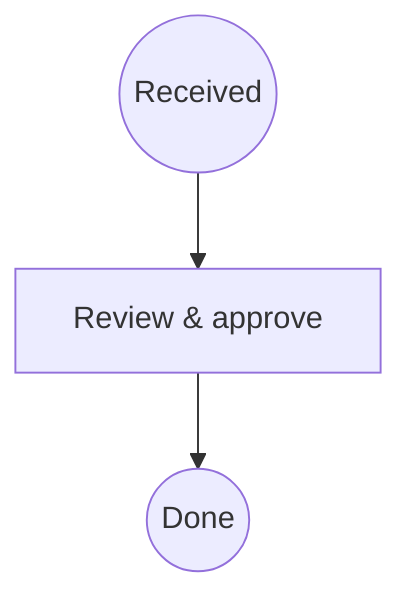

# BPMN-first Mermaid workflow

This Java 21 project has no external dependencies. `Model` supplies immutable
Document, Process, Node and Flow records; `BpmnExporter` writes a model to XML.
`BpmnReader` parses saved XML and `MermaidConverter` produces a simplified view.
The `.bpmn` file is the source of truth: file conversion never re-exports a Java
model to obtain the graph.

## Build and use from the Maven project root

Use a Java 21 JDK with the `jdk.compiler` module. Compilation uses Java 21 --release with all warnings treated as errors. Tests use explicit checks;
`-ea` is unnecessary. Build products are ignored by Git.

```sh
# Maven: compile, run the regression harness with XSD checks, package and install:
JAVA_HOME=/usr/lib/jvm/jdk-21.0.9-oracle-x64 /usr/lib/apache-netbeans/java/maven/bin/mvn --no-transfer-progress clean install

# Alternative without Maven, with optional trusted local schemas:
./build.sh "$PWD/schemas/BPMN20.xsd"

# Optional: build and test without XSD checks:
./build.sh

# Java model → saved XML:
java -cp target/classes bpmn.Example target/example.bpmn

# Saved XML → Mermaid:
java -cp target/classes bpmn.BpmnToMermaid \
  target/example.bpmn target/example.mmd

# Convert the existing checked-in example:
java -cp target/classes bpmn.BpmnToMermaid \
  examples/order-approval.bpmn \
  target/order-approval.mmd
```

The CLI requires exactly two paths, reads the input without changing it, and writes
UTF-8 Mermaid text plus a matching bare-bones HTML companion (`chart.mmd` →
`chart.html`; other output names get `.html` appended). Each HTML file embeds its
Mermaid text, so it does not need to fetch the `.mmd` file. Open it in a browser;
internet access is required to load the pinned Mermaid 12.3.0 renderer from
jsDelivr. The Java build and converter still have zero external dependencies.
It overwrites existing destinations on success and does not create
parent directories. Parsing and conversion finish before the output is opened, so
invalid input leaves both existing outputs untouched. Same-file paths (including
symlink/hard-link aliases among the input, Mermaid output and HTML output) are rejected. Invalid arguments return status 2;
conversion and file failures return status 1 with a concise stderr diagnostic.
An I/O failure during the final writes can leave partial or mismatched outputs;
the pair of writes is not transactional.

## Supported subset and visual mapping

Exactly one non-executable process is supported:

| BPMN element | Mermaid shape |
| --- | --- |
| plain startEvent / endEvent | circle |
| generic task | rectangle |
| exclusiveGateway | diamond marked X |
| parallelGateway | diamond marked + |
| sequenceFlow | directed edge, with its name as an optional label |

All nodes are emitted, including disconnected nodes. All sequence flows are emitted
in saved XML order, including branches, cycles and parallel edges. Node order also
follows saved XML order. Stable generated IDs (`n0`, `n1`, …) prevent BPMN IDs from
becoming Mermaid syntax. The API result includes an immutable BPMN-node-ID mapping.
Names are quoted and punctuation, control whitespace and Unicode are encoded as
Mermaid decimal entities. Empty node names fall back to BPMN IDs, except unnamed
gateways use their X/+ marker. These choices make output deterministic.

See [READER.md](READER.md) for the complete metadata whitelist and security contract.
Unknown elements and semantic attributes are rejected rather than omitted. This
includes subprocesses, event definitions, conditions/default flows, lanes,
collaborations, specialized tasks and extensions. BPMN DI layout is ignored.
IDs use the existing model's ASCII NCName subset. Local references, uniqueness and
start/end flow direction are checked; reachability and gateway balance are not.

DOCTYPE declarations are rejected. External entities, DTD/schema retrieval,
network access and XInclude processing are disabled. XML namespace URI and local
name determine element identity, so default namespaces and alternate prefixes work.

Mermaid is a simplified visual representation, not a BPMN execution format.
It does not encode execution semantics or BPMN layout. This project provides no
graphical editor or execution engine. Rendering needs a separate Mermaid viewer;
the HTML companion loads its renderer from a CDN. Browser rendering validation
was unavailable in this environment.

## Separate XSD validation

`BpmnValidator` checks schema conformance. `BpmnReader` independently checks the
converter's supported subset; XSD-valid BPMN can still use unsupported constructs.
Neither operation establishes complete BPMN semantic or engine compatibility.

Supply a trusted local bundle containing BPMN20.xsd, Semantic.xsd, BPMNDI.xsd,
DC.xsd and DI.xsd in one directory. The supplied local `schemas/` directory is
ignored by Git. The validator allows local imports while compiling trusted schemas
and disables external schema/DTD access when validating XML instances. It never
fetches schemas over the network.

```java
new bpmn.BpmnValidator(java.nio.file.Path.of("schemas/BPMN20.xsd"))
    .validate(java.nio.file.Files.readString(java.nio.file.Path.of("process.bpmn")));
var result = new bpmn.MermaidConverter().convert(java.nio.file.Path.of("process.bpmn"));
String mermaid = result.text();
java.util.Map<String, String> ids = result.nodeIds();
```

## Generated example

[order-approval.mmd](examples/order-approval.mmd) is generated directly from
[order-approval.bpmn](examples/order-approval.bpmn). The suite checks that it stays
in sync. To regenerate it, run from the Maven project root after building:

```sh
java -cp target/classes bpmn.BpmnToMermaid \
  examples/order-approval.bpmn \
  examples/order-approval.mmd
```



## Larger order-fulfillment example

`ComplexExample` contains 13 nodes and 14 flows: a three-way review decision,
a corrections/resubmission cycle, a rejection ending, and parallel stock reservation
and payment collection that join before shipping. Flow labels describe the branches;
they are not executable BPMN conditions.

From the Maven project root:

```sh
java -cp target/classes bpmn.ComplexExample \
  target/order-fulfillment.bpmn
java -cp target/classes bpmn.BpmnToMermaid \
  target/order-fulfillment.bpmn \
  target/order-fulfillment.mmd
```

Saved examples are in `examples/order-fulfillment.bpmn` and
`examples/order-fulfillment.mmd`. Tests check the saved XML against the Java model,
validate it with the optional supplied XSD, and check its generated Mermaid text.


## NetBeans / Maven migration

Open this directory as a Maven project. Sources use `src/main/java`, tests use
`src/test/java`, and build output lives in `target/`. No application or test library
dependencies are declared; Maven uses build plugins. Its test phase runs `bpmn.Tests`
through exec-maven-plugin in a separate JVM. Surefire may report no tests because
this is a plain Java harness, not JUnit; look for `Passed 117 checks` under
`bpmn-regression-checks`. A failing check fails the Maven build.

The checked-in `nbactions.xml` maps NetBeans Run Project (F6) directly to
`BpmnToMermaid`, with program arguments
`examples/order-fulfillment.bpmn target/order-fulfillment.mmd`. Change those paths
in Project Properties → Actions → Run Project to convert another example.
Run Project converts files; Clean and Build runs the regression harness separately.
The Java launcher class also delegates to `BpmnToMermaid`. The `target/` directory
exists after building. The packaged JAR is executable:

```sh
java -jar target/mavenproject2bpmnreader-1.0-SNAPSHOT.jar \
  examples/order-fulfillment.bpmn target/order-fulfillment.mmd
```

This writes both `target/order-fulfillment.mmd` and `target/order-fulfillment.html`.
Open the HTML in a browser with internet access to load Mermaid from the CDN.

The supplied schema bundle was copied into the ignored `schemas/` directory.
Maven runs XSD checks by default; override its location with
`-Dbpmn.schema=/absolute/path/to/BPMN20.xsd`. The alternative `build.sh` retains its
optional schema argument and can run without schema checks.

Migration leaves the original checkout intact, including its Git history and
uncommitted work. This destination retains its own existing Git history; no history
was rewritten, imported or pushed. The current migration is uncommitted.


If an older Run configuration contains `bpmn.Tests` or the schema path as application
arguments, use the project Run action from `nbactions.xml` (reload the project if
NetBeans has cached the old configuration). `bpmn.Tests` is a test-only entry point;
`process-classes` does not compile or put test classes on the application classpath.
# bpmnreader
# bpmnreader
# bpmnreader
